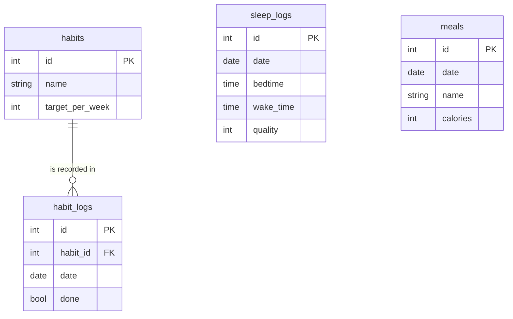

# Fitness Tracker

> Sleep and diet tracker for Android

**Status:** Active · **Access:** Public repository · [Source](https://github.com/Brian-Kareithi/Physical-Fitness)

## Purpose

Track sleep and diet in one Android app that stores everything on the device.

## Problem

Fitness apps buried the two things I track, sleep and diet. So I built a Kotlin app for exactly those.

## Target audience

| Audience | Needs |
| --- | --- |
| Me, as the daily user | Log sleep, meals and habits in seconds and see trends, without an account. |

## Scope

### In scope

- Sleep logging
- Meal and nutrition logging
- Habit tracking
- Progress charts

### Out of scope

- Cloud sync or accounts
- Social features
- Wearable integration

## Solution

1. Sleep and habit logging with progress charts
2. Meal logging and health metrics
3. Local-first with Room, no account or backend
4. Used daily and shaped by real use

## Architecture

Android UI (Kotlin) → Room Database → Local Storage

## Data model

## Design priorities

- Local-first and private
- Fast daily entry
- Offline by design

## Technology

Kotlin · Android SDK · Room Database · MPAndroidChart

## My contribution

Solo project. Designed, built and maintained by me.
