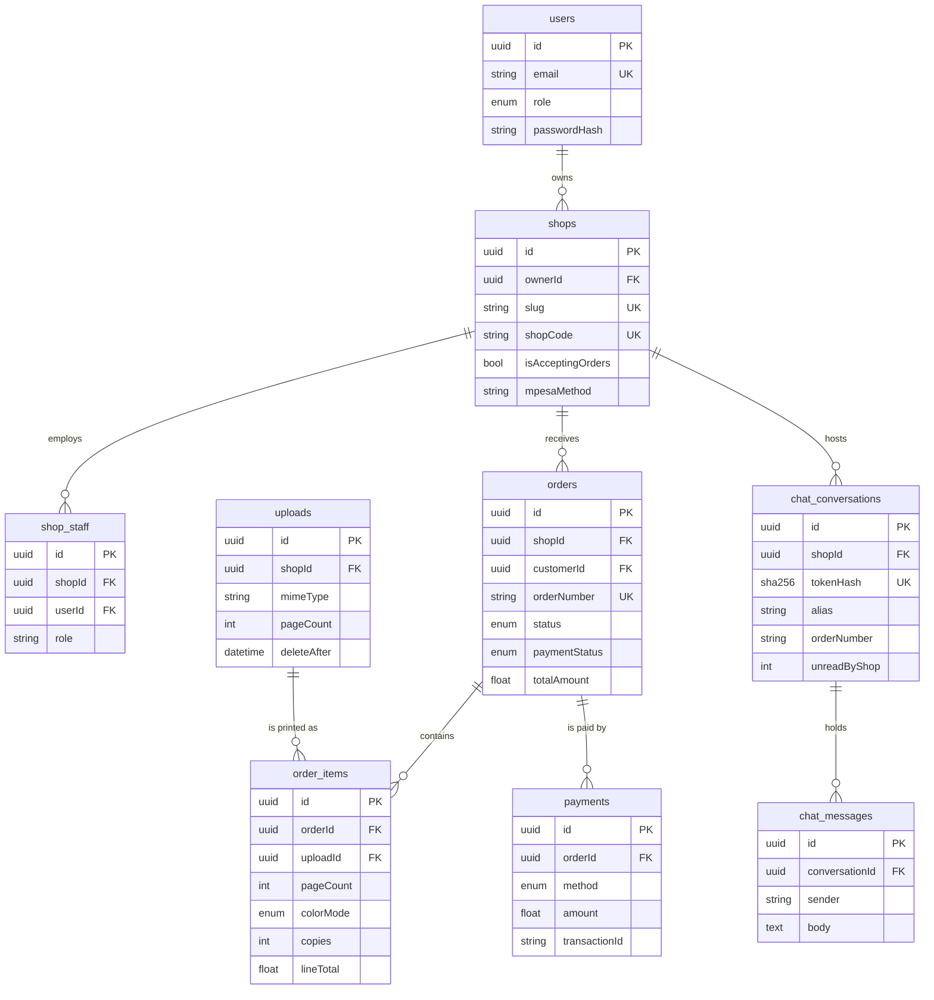

# QuickPrint

> Multi-tenant print-shop platform: web portal, Android app and a real-time API

**Status:** Shipped · **Access:** Three public repositories: web, API and Android · [Live demo](https://quickprint-ten.vercel.app)

## Purpose

Run a print shop from one QR code: customers send files and pay from their phone, chat with the shop if something changes, and the shop works a live queue.

## Problem

Cyber cafés and print shops run on WhatsApp attachments, flash drives and a shouted queue. QuickPrint gives each shop a QR code and a 5-character counter code: customers send files from a phone browser or the Android app, see an honest price, pay with M-Pesa or cash and chat with the shop, while the shop works a live queue.

## Target audience

| Audience | Needs |
| --- | --- |
| Print-shop customers | Send a file from a phone browser or the Android app, choose print options and see the price, with no account, and message the shop if they sent the wrong file. |
| Shop owners and cashiers | A live queue, payment status, customer chats and daily numbers, without chasing WhatsApp attachments. |
| Platform admins | Oversight of every shop, suspension controls and proof that customer files are being deleted on time. |

## Scope

### in the scope

- Shop-branded customer portal opened by QR poster, link or 5-character shop code
- Native Android customer app on the same API
- Server-side pricing from each shop's own rates
- Live print queue and searchable orders over Socket.IO
- Cash, M-Pesa, Airtel Money and bank payments
- Customer–shop chat with nicknames, live alerts and Android reply notifications
- Team and cashier access, branding and accepted file types
- Revenue, peak-hour and printer analytics
- Super-admin console, scheduled file and chat deletion, Terms & Privacy

### Out of scope

- Automatic STK Push and card checkout: customers pay the shop's own Till, Paybill or number, and staff confirm
- Printer drivers: jobs are printed from the shop's own machine
- An iOS app

## Codebases

| Part | What it does | Stack | Hosted on |
| --- | --- | --- | --- |
| [Web portal](https://github.com/Brian-Kareithi/QuickPrint) | Customer upload portal, shop dashboard with queue, orders, messages and analytics, and the super-admin console. | Next.js 16, React 19, Tailwind CSS 4, Socket.IO client, Recharts, Zod | Vercel |
| [API](https://github.com/Thee-Entity/QuickPrint-Backend) | Multi-tenant REST API with real-time queue and chat, server-side pricing, QR posters, rate limits and scheduled data retention. | NestJS 10, PostgreSQL, Prisma 6, Socket.IO, JWT, @nestjs/schedule | Railway |
| [Android app](https://github.com/Brian-Kareithi/QuickPrint-Android) | Customer app: connect by code, QR or link, upload, choose options, order, and chat with reply notifications. | Kotlin, Jetpack Compose, Material 3, OkHttp, WorkManager, Google code scanner | Android 7.0+ |

## Solution

1. Connect to a shop by QR poster, shop link or 5-character code, then upload with no account. Only the file types that shop accepts are offered, and PDF page counts are detected
2. Per-file print options (pages, copies, colour, paper, sides, quality, binding, finishing) priced by the server from the shop's own pricing rules
3. Cash, M-Pesa Till, Paybill or Send Money, Airtel Money and bank transfer, with the shop's exact payment steps and staff-confirmed payment status
4. A live print queue and searchable orders over Socket.IO, plus revenue, peak-hour and printer analytics, team and cashier access, and per-shop branding
5. Customer–shop chat under a fruit nickname such as Cute Pineapple 🍍. Shops get live toasts, desktop alerts and an unread count on the browser tab, and the Android app sends a notification only when the shop replies
6. Privacy by design: files are deleted an hour after an order is done, chats after 30 days, chat keys are stored only as SHA-256 hashes, and a Terms & Privacy page follows Kenya's Data Protection Act 2019

## Architecture

Next.js Web Portal + Android App → NestJS REST API → PostgreSQL (Prisma)

Branch from *NestJS REST API*: Socket.IO Queue & Chat · Retention Jobs.

## Data model

## Design priorities

- No account needed to print
- The server sets the price, never the client
- Files are deleted an hour after the order is done
- Chat keys are stored only as hashes
- One API for web and Android
- Liquid glass in light mode, flat dark mode

## Technology

Next.js 16 · React 19 · TypeScript · Tailwind CSS 4 · NestJS 10 · PostgreSQL · Prisma 6 · Socket.IO · JWT · Kotlin · Jetpack Compose · WorkManager · Docker · Railway · Vercel

## My contribution

Solo build across all three repositories: the NestJS API and data model, the Next.js customer portal, shop dashboard and admin console, and the native Android app, plus deployment on Railway and Vercel.
