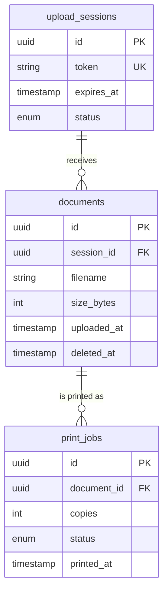

# QuickPrint

> QR-based document printing for cyber cafés

**Status:** Completed · **Access:** Public repository · [Source](https://github.com/Thee-Entity/QuickPrint-Client)

## Purpose

Replace flash drives at a cyber café with a phone-based upload that deletes itself after printing.

## Problem

Cyber café printing means handing a flash drive to a stranger's computer. QuickPrint replaces it with a self-service upload that deletes itself.

## Target audience

| Audience | Needs |
| --- | --- |
| Café customers | Send a document to print from their own phone, without handing over a drive. |
| Café operator | A single queue at the till and no leftover customer files. |

## Scope

### In scope

- QR code that opens a temporary upload page
- Upload to a transient server
- Print queue for the till
- Automatic deletion after printing

### Out of scope

- Customer accounts
- Payment handling
- Multi-till or multi-branch support

## Solution

1. Scan a QR code to open an upload page on your phone
2. Files print, then delete automatically
3. No flash drives or shared storage
4. Built for a single-till café workflow

## Architecture

Client (QR Upload) → Express API → SQLite

Branch from *Express API*: Auto-delete Job.

## Data model

## Design priorities

- Privacy: nothing persists after the job
- Works on any phone browser, no install
- Simple enough for one operator

## Technology

React · Node.js · Express · SQLite · QR Code API

## My contribution

Built end to end, from QR upload to file deletion.
